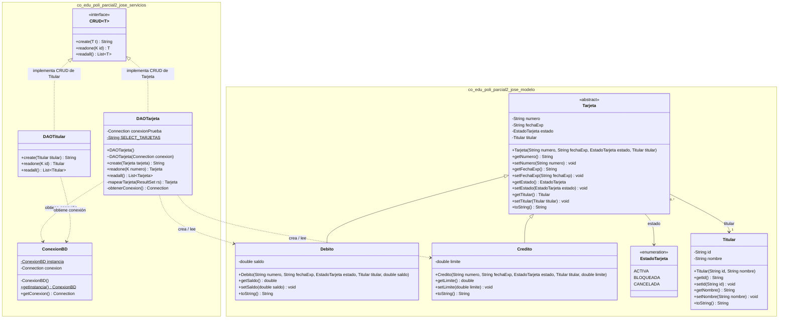
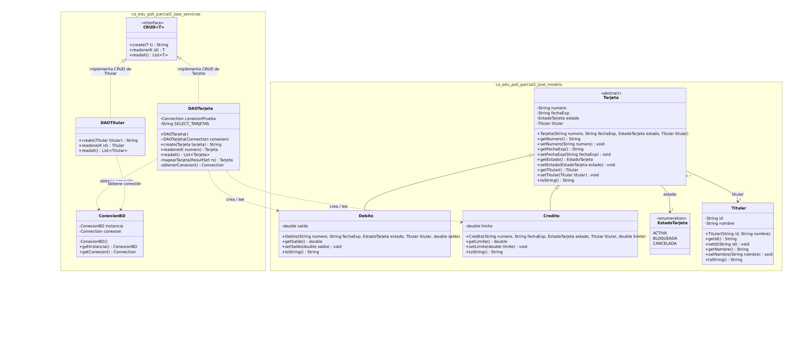

# Gestión de Tarjetas — JavaFX + MySQL

Aplicación de escritorio para crear y consultar tarjetas de débito y crédito
asociadas a un titular. Proyecto del Parcial Corte 2 de Practica aplicada de sistemas.

**Autor:** José — Politécnico Grancolombiano

## Tecnologías

Java 17 · JavaFX 17 · MySQL 8 · JDBC · Maven · JUnit 5 · dotenv-java

## Historia de usuario HU-01

> **Como** analista de crédito, **quiero** asignar un estado a una tarjeta
> **para** controlar si puede ser utilizada.

### Criterios de aceptación

- [x] La tarjeta puede estar **Activa**, **Bloqueada** o **Cancelada**.
- [x] El estado se almacena en la base de datos.
- [x] El formulario permite seleccionar el estado al crear una tarjeta.
- [x] La aplicación exige seleccionar un estado antes de guardar.
- [x] El DAO y la base de datos rechazan estados nulos o fuera de los valores permitidos.

## Estimación

**5 puntos de historia (aproximadamente 11 horas).** La historia involucra
el modelo, la base de datos, el DAO, la interfaz y pruebas unitarias y de integración.

| # | Tarea | Horas |
|---|---|---:|
| 1 | Análisis y actualización del diseño UML | 0.5 |
| 2 | Crear el enum `EstadoTarjeta` | 0.25 |
| 3 | Actualizar `Tarjeta`, `Debito` y `Credito` para manejar el estado | 1 |
| 4 | Actualizar el script SQL con `estado VARCHAR(10)`, `CHECK` y `NOT NULL` | 0.75 |
| 5 | Actualizar `DAOTarjeta` para persistir y leer el estado | 1 |
| 6 | Agregar al formulario un selector obligatorio de estado | 1.5 |
| 7 | Crear pruebas unitarias | 1 |
| 8 | Crear pruebas de integración con MySQL | 1.5 |
| 9 | Generar documentación Javadoc | 1 |
| 10 | Preparar README, wiki y UML | 1 |
| 11 | Grabar video de evidencia | 1.5 |
| | **Total** | **11** |

## Requisitos previos

- JDK 17 o compatible.
- Maven.
- MySQL 8 en ejecución.
- MySQL Workbench (opcional, para revisar la base de datos).

## Configuración de MySQL

1. Abre [parcial_tarjetas_jose.sql](./parcial_tarjetas_jose.sql) en MySQL Workbench y ejecútalo **una sola vez** para crear el esquema, las tablas y los datos iniciales.
2. En la carpeta raíz del proyecto, configura el archivo local `.env` con tus propios datos:

   ```dotenv
   DB_URL=jdbc:mysql://127.0.0.1:3306/parcial_tarjetas_jose?serverTimezone=UTC
   DB_USER=tu_usuario
   DB_PASSWORD=tu_contrasena
   ```

3. No publiques ni compartas el contenido real de `.env`; contiene credenciales y está excluido del control de versiones.

> El script inserta titulares y tarjetas de ejemplo. Aunque crea las tablas con
> `IF NOT EXISTS`, los `INSERT` de ejemplo no son idempotentes: no lo vuelvas a
> ejecutar sobre un esquema que ya tenga esos datos, pues puede producir claves
> duplicadas.

## Ejecución

Desde la carpeta raíz del proyecto:

```powershell
mvn javafx:run
```

También puedes abrir en VS Code la carpeta del proyecto y ejecutar la
configuración **Ejecutar Parcial 2** con `F5`.

## Pruebas

Ejecuta la suite con:

```powershell
mvn clean test
```

- **Unitarias:** `TarjetaTest`, para los modelos y los estados.
- **Integración:** `DAOTarjetaIntegrationTest`, para las operaciones del DAO contra MySQL.
- Las pruebas de integración necesitan MySQL, el esquema inicializado y `.env` configurado. Si no se puede establecer la conexión, JUnit las omite mediante una suposición.

> **Precaución con los datos:** la prueba de integración usa el titular fijo
> `T-ITEST` y limpia tarjetas cuyo número comienza por `9999`. Ejecútala solo
> en una base de desarrollo/pruebas donde esos datos estén reservados; no la
> ejecutes en una base con tarjetas reales que puedan coincidir con ese prefijo.

Para guardar una copia de la salida de Maven en PowerShell:

```powershell
mvn clean test | Tee-Object -FilePath docs/evidencia-pruebas.txt
```

La evidencia generada se guarda en
[docs/evidencia-pruebas.txt](./docs/evidencia-pruebas.txt).

## Documentación

- **JavaDoc (en línea):** https://djose2077.github.io/parcial-corte2/javadoc/index.html
  - También está en el repo: [docs/javadoc](https://github.com/djose2077/parcial-corte2/tree/main/docs/javadoc)
  - Para regenerarlo: `mvn javadoc:javadoc`
- **Script de base de datos:** [parcial_tarjetas_jose.sql](https://github.com/djose2077/parcial-corte2/blob/main/parcial_tarjetas_jose.sql)
- **Wiki** (UML actualizado y video de evidencia): https://github.com/djose2077/parcial-corte2/wiki
- **Video de evidencia:** _pega aquí el enlace cuando lo subas_
- **Evidencia de pruebas:** [docs/evidencia-pruebas.txt](https://github.com/djose2077/parcial-corte2/blob/main/docs/evidencia-pruebas.txt)

## Estructura del proyecto

```text
src/main/java/co/edu/poli/parcial2_jose/
  modelo/        Tarjeta, Debito, Credito, Titular, EstadoTarjeta
  servicios/     ConexionBD, CRUD, DAOTarjeta, DAOTitular
  controlador/   ControlFormCard
  vista/         App
src/test/java/
  modelo/        TarjetaTest
  servicios/     DAOTarjetaIntegrationTest
docs/
  evidencia-pruebas.txt
  javadoc/
```

## Diagrama de clases: modelo y servicios




## Uso de herramientas de inteligencia artificial

Se utilizó Claude y GitHub Copilot como apoyo para planear y revisar
cambios, preparar borradores de pruebas y documentación. El código se revisó
y adaptó al proyecto antes de integrarlo; las pruebas se ejecutan con Maven.
